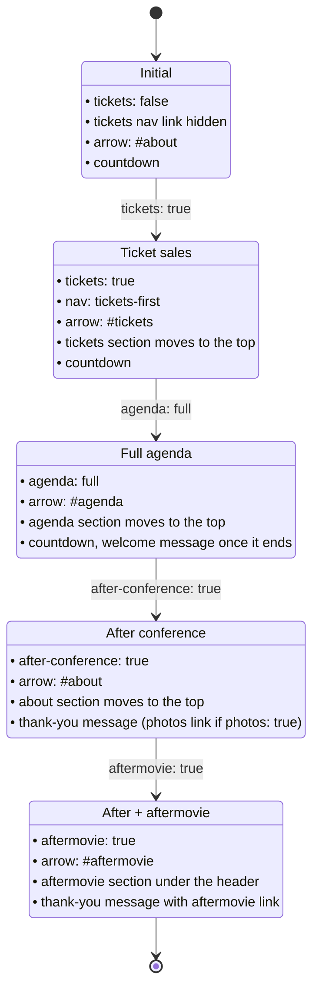

# Site state

How the flags in `_data/state.yml` change the site.

Note: Mermaid renders on GitHub and in VS Code (with the Markdown Preview extension).

## Conference phases

The usual order in which the flags are switched on during the conference cycle. Each state keeps the flags set before it. The logic lives in `_includes/state.html`, `_includes/nav.html`, `_includes/header.html` and `_layouts/conference.html`.

## Other flags

| Flag | Effect |
|---|---|
| `agenda` | `"draft"` shows the draft agenda after about and tickets, and an about-section button pointing to it; `"full"` is covered by the diagram |
| `invited-speakers` | `null` hides, `"first"` shows with "more coming", `"all"` shows final |
| `cfc` | `null` hides, `"open"`, `"closed"`, `"after"` change the calls section; `open` also enables the Call for Tutorials nav link |
| `call-for-sponsors` | shows the sponsors call section and nav item |
| `photos` | selects the header message with the photos link; the Photos nav link needs the `/photos` page published |
| `next-year-site` | "next year" links point to the next edition's site instead of the local `/next-year` page |
| `banner-text` | shows the banner under the header |
